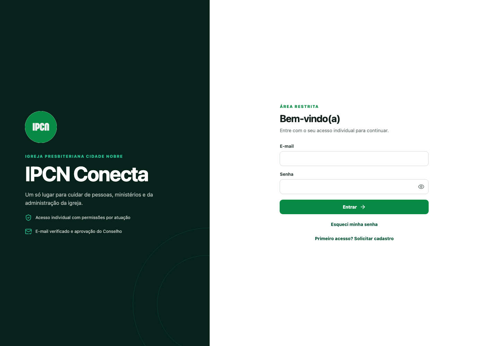
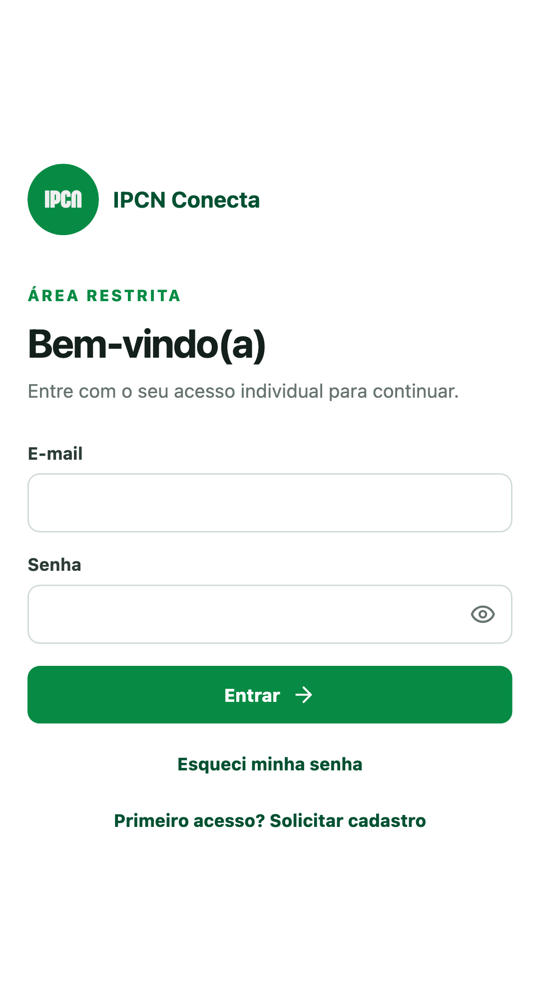

# IPCN Conecta

[](https://github.com/jaosiman000-jpg/ipcnconecta/actions/workflows/ci.yml)

Sistema interno de gestão da Igreja Presbiteriana Cidade Nobre, construído para funcionar bem em computadores simples e celulares.

Produção: [ipcnconecta.vercel.app](https://ipcnconecta.vercel.app)

> Este repositório é público, mas a aplicação é privada. Nenhuma credencial, exportação do banco ou informação de membros deve ser adicionada ao Git.

## Capturas de tela

| Computador | Celular |
| --- | --- |
|  |  |

As capturas usam somente a tela pública de login e não exibem dados pessoais.

## Funcionalidades

- Login real com Firebase Authentication, verificação de e-mail e recuperação de senha.
- Solicitação de acesso com foto e atuações desejadas.
- Aprovação por Administrador ou Conselho.
- Papéis cumulativos no mesmo login.
- Cadastro unificado de pessoas com vínculos independentes de membro, EBD e dízimos.
- Matrícula da EBD e número de membro gerados separadamente pelo servidor.
- Área pastoral restrita ao Conselho e Administração.
- Visitantes, consentimento e contato manual pelo WhatsApp.
- Classes, professores, alunos, chamadas aos domingos e relatórios da EBD.
- Sociedades internas UCP, UPA, UMP, UPH e SAF.
- Financeiro da Junta Diaconal com lotes de dízimos, ofertas e missões em dinheiro ou PIX.
- Relatórios e exportação de planilhas.
- Auditoria das alterações.
- Sincronização em tempo real entre computadores e celulares.
- PWA instalável com ícone da IPCN.
- Escritas administrativas validadas por uma Vercel Function em `POST /api/mutations`.
- Vercel Function de diagnóstico em `GET /api/health`.

Uploads de documentos e comprovantes já possuem código e regras preparados, mas permanecem desabilitados até a ativação segura do Firebase Storage.

## Papéis de acesso

| Papel | Acesso principal |
| --- | --- |
| Administrador | Acesso completo |
| Conselho | Mesmo acesso do Administrador |
| Secretaria | Membros, visitantes, EBD, sociedades e relatórios |
| Junta Diaconal | Registro e cancelamento justificado de contribuições e relatórios financeiros |
| Professor | Chamada e relatório das classes atribuídas |
| Líder | Sociedades atribuídas e pedidos de inclusão |
| Acolhimento | Cadastro, consulta e contato de visitantes |

Itens sem permissão não aparecem na interface. As regras do Firestore repetem a autorização no banco; esconder um botão não é tratado como controle de segurança.

## Stack

- React 18 e TypeScript.
- Vite 6.
- React Router.
- Firebase Authentication.
- Cloud Firestore em tempo real.
- Firebase Storage preparado, aguardando ativação.
- Vercel Functions no runtime Node.js.
- PWA com Web App Manifest e Service Worker próprio.
- ExcelJS para exportações.
- Vitest para testes.
- GitHub Actions para integração contínua.
- Vercel para previews e produção.

## Arquitetura

Firebase é responsável pela autenticação, pelas leituras em tempo real e pelo armazenamento. As escritas administrativas passam por uma Vercel Function, que repete autenticação, autorização e validação no servidor. A Function acessa o Google Cloud por identidade federada OIDC, sem chave privada permanente. Não existe um servidor tradicional para manter ou dimensionar.

O Service Worker armazena somente HTML e arquivos estáticos. Ele ignora `/api` e todos os serviços externos do Firebase para não persistir dados pessoais ou pastorais no cache PWA.

Leia [docs/ARCHITECTURE.md](docs/ARCHITECTURE.md) para o mapa completo de serviços, coleções, permissões e CI/CD.

## Executar localmente

Requisitos:

- Node.js 22, 23 ou 24.
- npm.
- Um projeto Firebase próprio para desenvolvimento.

Instalação:

```bash
git clone https://github.com/jaosiman000-jpg/ipcnconecta.git
cd ipcnconecta
npm install
cp .env.example .env.local
npm run dev
```

Preencha `.env.local` com a configuração pública do seu projeto Firebase:

```dotenv
VITE_FIREBASE_API_KEY=
VITE_FIREBASE_AUTH_DOMAIN=
VITE_FIREBASE_PROJECT_ID=
VITE_FIREBASE_STORAGE_BUCKET=
VITE_FIREBASE_MESSAGING_SENDER_ID=
VITE_FIREBASE_APP_ID=
VITE_FIREBASE_STORAGE_ENABLED=false
```

As variáveis `VITE_*` fazem parte da configuração pública do aplicativo web Firebase, mas ainda devem permanecer fora do Git para evitar mistura entre ambientes. As variáveis `GCP_*` são usadas somente pela Function e identificam a federação configurada em produção; elas não substituem nem contêm uma chave privada.

### Testar Vercel Functions localmente

```bash
npm install -g vercel@latest
vercel link
npm run dev:vercel
```

O frontend isolado funciona com `npm run dev`. O fluxo privilegiado de `POST /api/mutations` depende da identidade OIDC emitida em um deployment da Vercel. Não conecte um preview ou ambiente local ao banco de produção; para testes integrados, use um projeto Firebase separado e uma identidade própria para esse ambiente.

O provisionamento seguro da Function está documentado em [docs/SECURE_FUNCTIONS.md](docs/SECURE_FUNCTIONS.md).

## Validação

```bash
npm run check
```

Esse comando executa testes, build de produção e validações do manifesto e da política de cache do PWA.

## CI/CD

- Pushes e pull requests para `main` executam o workflow de qualidade no GitHub Actions.
- Branches e pull requests recebem um preview da Vercel quando a integração Git está ativa.
- `main` é a branch de produção.
- Variáveis de ambiente são configuradas na Vercel; nenhum token de deploy fica no repositório.

## Estrutura principal

```text
api/                    Vercel Functions
docs/                   Arquitetura e capturas públicas
public/                 Logo, ícones, manifesto e Service Worker
scripts/                Validações auxiliares
src/app/                Firebase, estado, permissões e tipos
src/components/         Componentes compartilhados
src/pages/              Módulos do sistema
src/styles/             Estilos globais
firestore.rules         Autorização do banco
storage.rules           Autorização de arquivos
```

## Segurança e LGPD

Antes de alterar autenticação, permissões, dados pastorais, visitantes ou financeiro, leia [SECURITY_AND_LGPD.md](SECURITY_AND_LGPD.md).

Regras obrigatórias para contribuições:

- não usar dados reais em testes ou screenshots;
- não enviar `.env`, tokens, chaves privadas ou arquivos exportados;
- validar permissões na interface e no serviço de dados;
- executar `npm run check` antes de abrir um pull request.

Veja também [CONTRIBUTING.md](CONTRIBUTING.md).

## Estado atual e próximos passos

- Firestore e sincronização em tempo real: implementados.
- PWA e Service Worker seguro: implementados.
- CI no GitHub e deploy contínuo na Vercel: implementados.
- Firebase Storage: código e regras prontos, aguardando plano e bucket.
- Backup semanal: ainda não implementado.
- Operações administrativas em Vercel Functions: publicadas em produção com identidade OIDC e sem chave privada permanente. Falta validar uma operação autenticada real antes de publicar as regras restritivas do Firestore.

Este projeto ainda é um MVP e deve passar por revisão técnica e jurídica antes de armazenar grandes volumes de dados reais.
