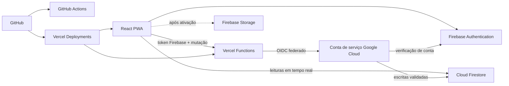

# Arquitetura

## Visão geral

## Responsabilidades

- React/Vite: interface, navegação e controles visuais por permissão.
- Firebase Authentication: criação de conta, login, verificação de e-mail e recuperação de senha.
- Cloud Firestore: persistência e sincronização em tempo real.
- Firestore Rules: autorização de leitura por papel e escopo e bloqueio das escritas administrativas do navegador.
- Vercel Functions: `GET /api/health` para diagnóstico e `POST /api/mutations` para escritas autenticadas, autorizadas, validadas e auditadas.
- Workload Identity Federation: entrega à Function acesso temporário de menor privilégio, sem chave privada armazenada na Vercel ou no Git.
- Firebase Storage: documentos e comprovantes, ainda desativado até existir um bucket com regras publicadas.
- Service Worker: cache exclusivo do shell estático; não intercepta `/api` nem serviços externos do Firebase.

## Coleções principais

- `users`: perfis, papéis e escopos.
- `people`: cadastro mestre; cada pessoa pode possuir vínculos independentes com membros, EBD e dízimos.
- `users.personId` e `people.authUserId`: vínculo 1:1 entre a credencial de acesso e o cadastro mestre, validado em transação pelo backend.
- `members`: projeção dos dados gerais das pessoas oficialmente recebidas como membros.
- `memberDirectory`: diretório mínimo de membros para os fluxos das sociedades.
- `memberPrivate`: observações e documentos pastorais restritos.
- `visitors`: cadastro e acompanhamento de visitantes.
- `ebdClasses` e `attendance`: classes e chamadas da EBD.
- `societies` e `societyRequests`: sociedades e pedidos de inclusão.
- `ebdDirectory`: diretório mínimo dos alunos, consultado por professores somente nas classes atribuídas.
- `financeDirectory`: diretório mínimo de contribuintes disponível para a Junta Diaconal.
- `financeBatches`: rascunhos e metadados dos lotes de contribuições.
- `financeEntries`: contribuições finalizadas e cancelamentos preservados no histórico.
- `audit`: histórico imutável de ações.
- `appSettings/general`: configurações gerais.
- `systemCounters/people`: próximas sequências de matrícula EBD e número de membro.
- `dataImports`: marcadores técnicos que impedem a repetição de importações.

## Autorização

Administrador e Conselho são superusuários. Secretaria, Junta Diaconal, Professor, Líder e Acolhimento recebem apenas os módulos necessários. Papéis são cumulativos. Classes e sociedades também possuem escopos próprios.

Na aprovação de uma conta, Administrador ou Conselho deve selecionar uma pessoa já cadastrada. O backend impede que duas contas usem a mesma pessoa e registra toda criação ou correção de vínculo na auditoria.

## CI/CD

- Pull requests e pushes em `main` executam instalação limpa, testes, build e validação do PWA no GitHub Actions.
- A integração Git da Vercel cria previews para branches e pull requests.
- A branch `main` publica em produção após as validações configuradas na Vercel.
- Variáveis de ambiente permanecem na Vercel e no ambiente local; nunca entram no Git.

## Decisão de backend

Não há um servidor tradicional separado. Vercel Functions é o backend HTTP e escala sob demanda. Firebase continua como backend de autenticação, leituras em tempo real e arquivos.

O navegador pode criar o próprio perfil pendente e sincronizar a confirmação do próprio e-mail. Todas as outras escritas passam por `POST /api/mutations`. A Function valida o token Firebase, recarrega o perfil no Firestore, confere papel e escopo, valida o contrato da operação e grava o evento de auditoria no mesmo lote ou transação.

O procedimento de provisionamento e a ordem segura de publicação estão em [SECURE_FUNCTIONS.md](SECURE_FUNCTIONS.md).
