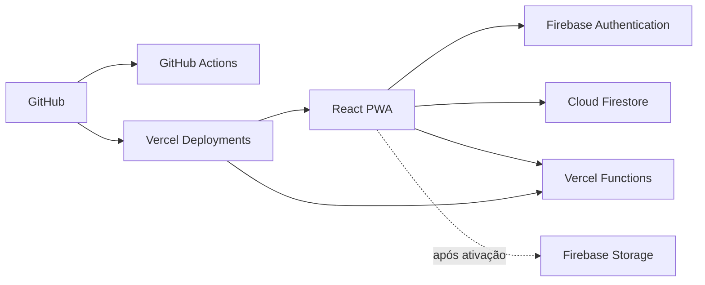

# Arquitetura

## Visão geral

## Responsabilidades

- React/Vite: interface, navegação e controles visuais por permissão.
- Firebase Authentication: criação de conta, login, verificação de e-mail e recuperação de senha.
- Cloud Firestore: persistência e sincronização em tempo real.
- Firestore Rules: autorização efetiva por papel e escopo; a interface não é a única proteção.
- Vercel Functions: endpoints HTTP que precisam executar no servidor. A primeira rota é `GET /api/health`.
- Firebase Storage: documentos e comprovantes, ainda desativado até existir um bucket com regras publicadas.
- Service Worker: cache exclusivo do shell estático; não intercepta `/api` nem serviços externos do Firebase.

## Coleções principais

- `users`: perfis, papéis e escopos.
- `members`: dados gerais dos membros.
- `memberDirectory`: diretório mínimo para professores e líderes.
- `memberPrivate`: observações e documentos pastorais restritos.
- `visitors`: cadastro e acompanhamento de visitantes.
- `ebdClasses` e `attendance`: classes e chamadas da EBD.
- `societies` e `societyRequests`: sociedades e pedidos de inclusão.
- `financeEntries`: lançamentos financeiros.
- `audit`: histórico imutável de ações.
- `appSettings/general`: configurações gerais.

## Autorização

Administrador e Conselho são superusuários. Secretaria, Tesouraria, Professor, Líder e Acolhimento recebem apenas os módulos necessários. Papéis são cumulativos. Classes e sociedades também possuem escopos próprios.

## CI/CD

- Pull requests e pushes em `main` executam instalação limpa, testes, build e validação do PWA no GitHub Actions.
- A integração Git da Vercel cria previews para branches e pull requests.
- A branch `main` publica em produção após as validações configuradas na Vercel.
- Variáveis de ambiente permanecem na Vercel e no ambiente local; nunca entram no Git.

## Decisão de backend

Não há um servidor tradicional separado. Vercel Functions é o backend HTTP e escala sob demanda. Firebase continua como backend de autenticação e dados em tempo real. Novas operações privilegiadas devem entrar em Functions somente quando houver validação do token Firebase, autorização no servidor e credenciais protegidas na Vercel.
